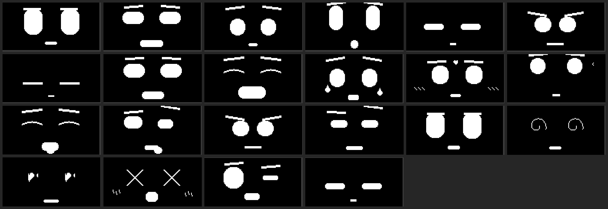

# OLED Face Pendant

[简体中文](README.md) | **English**

An ESP32-C3 desktop companion with a 128×64 OLED screen that shows **22 hand-drawn pixel-art expressions**, reacts to touch, falls asleep when ignored, and is fully controllable from a phone browser over Wi-Fi.

No animation files, no sprite sheets — every face is drawn procedurally with eyes, brows, and a mouth, so expressions can ease between states smoothly at ~30 fps.



---

## Download

**[-> Download v8 firmware (latest)](https://github.com/zhang-23x/oled-face-pendant/releases/tag/v8)**

| File | Use | Size |
|---|---|---|
| [`oled-face-pendant-v8-merged.bin`](https://github.com/zhang-23x/oled-face-pendant/releases/download/v8/oled-face-pendant-v8-merged.bin) | **Recommended.** Full 4 MB image, flash at `0x0` | 4.0 MB |
| [`oled-face-pendant-v8-app.bin`](https://github.com/zhang-23x/oled-face-pendant/releases/download/v8/oled-face-pendant-v8-app.bin) | App partition only (keeps bootloader and partition table) | 1.0 MB |
| [`oled_face_pendant.ino`](https://github.com/zhang-23x/oled-face-pendant/releases/download/v8/oled_face_pendant.ino) | Source code | 64.5 KB |

Flash the whole image (easiest for a new board):

```bash
esptool.py --chip esp32c3 --port COM5 --baud 921600 \
  write_flash 0x0 oled-face-pendant-v8-merged.bin
```

**You must reset afterwards** or the screen stays black (see [the trap](#the-trap-that-cost-me-a-day)):

```bash
esptool.py --chip esp32c3 --port COM5 --before no-reset --after watchdog-reset chip-id
```

SHA256:

```
f9c50bea5c0b9b4f702a80b56ab1cce90cdfd97144d98e8fca588045ca132c6b  merged.bin
361e06de278ad95bf3c428e58f7db9e3756f907aa65197a24d083a71582c65a9  app.bin
1d96a83c59e4c21ca55384531ada0a751aae935907c1106eeab18ddbd1f0cef4  .ino
```
---

## What you need (minimum)

### Four parts, none optional

| # | Part | Spec | ~Price |
|---|---|---|---|
| 1 | **ESP32-C3 dev board** | 4 MB flash, USB-C, native USB (CDC) | $2 |
| 2 | **0.96" OLED** | SSD1306, **4-pin I2C** (GND/VCC/SCL/SDA), 128x64 | $1.5 |
| 3 | **TTP223 touch modules** | capacitive, digital OUT | $0.3 x2 |
| 4 | **Jumper wires + USB cable** | 8 female-female; cable must carry data | $0.5 |

**About $4-5 total.**

### Board requirements

- Chip must be **ESP32-C3** (not S2 / S3 / C6)
- **4 MB flash** (the merged image is laid out for 4 MB)
- **Native USB** with CDC, so `Serial` goes straight over USB without an adapter
- A **RST button** on the board is strongly preferred

### Don't buy the wrong OLED

- **4-pin I2C**, not 7-pin SPI
- **SSD1306** (SH1106 also runs but shifts the image 2 px)
- **128x64** (a 128x32 panel only shows half the face)

### What you can skip

| Skip | Result |
|---|---|
| Touch modules | **Still runs.** Boots to NEUTRAL, controlled from the web page. No gestures |
| OLED | Doesn't run |
| Acrylic case | **Still runs.** Bare board on a desk |

---

## Why this exists

Most OLED "emoji" projects just cycle through a folder of bitmaps. This one treats the face as a **live rig**:

- Eyes are capsules whose width / height / radius are interpolated every frame
- Brows move independently with a `drop` offset and can go negative (with clamping — see [the trap](#the-trap-that-cost-me-a-day))
- The mouth is a single bezier-ish shape whose curvature and corner lifts are driven by emotion
- Extra states (spiral eyes, X eyes, heart eyes, tears, blush, z's, hearts) are layered on top

That means **new expressions cost 4 lines of parameters, not 1 KB of bitmap.**

---

## The 22 expressions

| | | | | | |
|---|---|---|---|---|---|
| 0 NEUTRAL | 1 HAPPY | 2 SAD | 3 SURPRISED | 4 SLEEPY | 5 ANGRY |
| 6 SLEEPING | 7 YAWN | 8 LAUGH | 9 BLINK | 10 BATTLE | 11 CRY |
| 12 SHY | 13 THINK | 14 YUMMY | 15 MOCK | 16 MUSIC | 17 CONFIDENT |
| 18 PANIC | 19 DIZZY | 20 LOVE | 21 SNEEZE | | |

Individual 128×64 captures are in [`docs/faces/`](docs/faces/) — these are raw frame-buffer dumps from the real device, not renders.

---

## Behaviour

### Idle timeline

```
last touch
   │
   ├─ +3.0 s   random face #1
   ├─ +10.3 s  random face #2      ← all three re-rolled every round
   ├─ +17.7 s  random face #3
   ├─ +25.0 s  yawn (900 ms)
   ├─ +25.9 s  drowsy  (lids half down, z's appear)
   └─ +30.0 s  asleep  (breathing gets faster)
        │
        └─ if loop mode is on: a 2 px border crawls around the screen edge
           from the top-left corner, and at 60 s the pendant wakes up and
           starts the whole cycle over
```

### The three on-screen badges

All badges show for 1.5 seconds and then vanish -- they never sit on the screen.

| Where | Icon | When |
|---|---|---|
| top-left | closed padlock | `A+B` held -> **locked** |
| top-left | open padlock (shackle lifted, gap above body) | `A+B` held -> **unlocked** |
| top-left | small alarm clock | `B` double-tap -> countdown **on** |
| top-left | alarm clock + slash | `B` double-tap -> countdown **off** |
| bottom-right | hourglass | stays while the loop countdown runs |

**Reading the hourglass** (13x11 px at `(109, 52)`):

```
  ┌───────────┐   top rail
  │ █████████ │   upper chamber: starts full, one row drops every 15 s
  │  ███████  │
  │   █████   │   4 rows = 60 s
  │     █     │
  │     │     │   neck: one grain falls every 250 ms
  │    ···    │   lower chamber: fills up as it drains
  │  ·······  │
  │···········│
  └───────────┘   bottom rail
```

Sand only, no side walls -- 9 px of height cannot draw a glass curve, so the
trapezoid shape carries the meaning.

### Gestures

| Gesture | Awake | Drowsy / asleep |
|---|---|---|
| **A single tap** | shy + 3 hearts | wake → surprised → happy |
| **A long press** | neutral + 3 hearts, then 700 ms later love + 3 hearts | ignored |
| **A double tap** | laugh + 6 hearts floating up | ignored |
| **B single tap** | next face in rotation | ignored |
| **B double tap** | toggle 60 s sleep loop | ignored |
| **B long press** | restart the OLED (re-runs `u8g2.begin()`, also rescues a stuck I²C bus) | same |
| **A+B hold 2 s** | lock / unlock keys A and B | same |

**What "lock" actually means:** it only disables gesture recognition on A and B, and draws a small padlock in the top-left corner. Every timer, the sleep state machine, the 60 s loop, the random face show, and the auto-rotation keep running untouched. Unlocking resumes with no state reset.

> This was originally implemented wrong — locking froze the whole state machine, so the 60 s countdown stopped advancing and the pendant slept forever. If you are porting this, do not gate your timers on the lock flag.

### Web control

- AP SSID: `FacePendant`
- Password: `face1234`
- URL: `http://192.168.4.1`
- The AP shuts itself off after 60 s of no requests

The page lets you tap any of the 22 faces, see live status (current face, brightness, uptime, time since last touch, loop countdown, lock state), and toggle brightness / lock / loop.

### Serial commands (115200)

| Command | Effect |
|---|---|
| `0`–`21` | switch to that face |
| `P` | dump the current 1024-byte frame buffer as `[dump]<face>:<2048 hex chars>` |
| `K` | toggle loop mode (same as B double tap) |
| `R` | toggle lock (same as A+B hold) |

The `P` command is how all the images in `docs/faces/` were produced. See [`tools/dump_preview.py`](tools/dump_preview.py).

---

## Wiring

| Signal | Pin | Notes |
|---|---|---|
| OLED SCL | GPIO4 | 400 kHz |
| OLED SDA | GPIO3 | 400 kHz |
| OLED VCC | 3V3 | |
| OLED GND | GND | |
| Touch module power | GPIO7 | powers the TTP223 from an IO pin (high, ~2 mA) — saves a wire |
| Key A out | GPIO6 | TTP223 push-pull output |
| Key B out | GPIO10 | TTP223 push-pull output, internal pulldown |
| A/B GND | GND | common ground required |

Key A's polarity is auto-detected at boot (12 samples). Key B is **always active-high**, because the internal pulldown guarantees it can only ever pull high when touched.

### Boot self-check

```
=== OLED keychain face boot ===
[touch] A idle high=0/12 -> HIGH | B fixed HIGH    ← must be 0/12 or 12/12
[touch] init A=0 B=0
[i2c] devices: 0x3C                                 ← without this line the panel is not connected
[wifi] AP "FacePendant"  pass "face1234"  ->  http://192.168.4.1
[boot] ready, touch to change face
```

If you see instead:

```
[i2c] devices: none
[touch] key A jitter (31 flips/2s) -> disabled, check 3V3 and OUT wiring
```

then your **3V3 or GND is broken** — the panel and the touch module failing together almost always means a shared rail, not two separate loose wires.

---

## The trap that cost me a day

`u8g2.drawLine()` takes **unsigned** coordinates. Passing a negative one does not clip it — it becomes something like `0xFFFFFFxx` and draws a line clean across the entire screen, straight through both eyes. It looked like a memory corruption bug. It was not.

Every drawing call in this project clamps its coordinates:

```cpp
int x1 = clamp(cx - half, 0, 127);
int y1 = clamp(cy - half, 0, 63);
```

Two other landmines:

1. **The board will not restart after uploading.** The RTS line on this particular C3 reaches nothing. `arduino-cli upload` finishes with `Hash of data verified` and then the pendant just sits there dark. Either press RST by hand, or send a watchdog reset with esptool.
2. **`WebServer` does not bind port 80 on core 3.3.x here.** Replaced with a hand-written `WiFiServer` writing in 512-byte chunks with an explicit `flush()`.

---

## Build

Tested with `esp32` core 3.3.10 and Arduino CLI.

```bash
# compile
arduino-cli compile \
  --fqbn esp32:esp32:esp32c3:CDCOnBoot=cdc \
  --build-path ./build \
  firmware/oled_face_pendant

# flash (check the port first — it moves after replugging)
arduino-cli board list
arduino-cli upload \
  --fqbn esp32:esp32:esp32c3:CDCOnBoot=cdc \
  --build-path ./build \
  -p /dev/ttyACM0 \
  firmware/oled_face_pendant
```

Resource use: **1,030,509 bytes of 1,310,720 (78 %)** program space, ~12 % RAM.

Library dependencies: `U8g2` by oliver (only external library).

---

## Adding your own expression

1. Add the name to `enum Emotion` (before `EMO_COUNT`)
2. Add a `case` in `setEmotion()` with eye / brow / mouth parameters
3. Optionally add decorations in `drawDeco()`

The eye styles are selected by `gEyeStyle`:

| value | style |
|---|---|
| 0 | capsule (default) |
| 1 | arc / crescent |
| 2 | spiral |
| 3 | cross (X) |
| 4 | heart |

Example — the whole definition of `LOVE`:

```cpp
case LOVE:                                 // heart eyes + smile arc
  setEyeTargets(lx, cy, 22, 22, rx, cy, 22, 22);
  setMouthTargets(mx, my + 2, 20, 4);
  setBrows(lx, 0, 12, 0, rx, 0, 12, 0, false);
  gEyeStyle = 4;                           // switch eyes to heart-shaped
  break;
```

Five lines, no bitmap, and it eases in from whatever face was showing before.

---

## License

MIT — see [LICENSE](LICENSE).

The expressions are hand-tuned parameters, not copied assets. If you build something with it, a link back is appreciated but not required.
