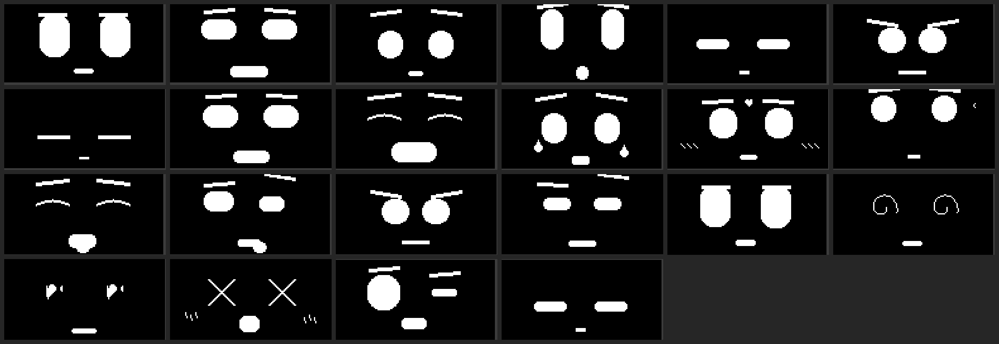

# OLED 表情挂件

**简体中文** | [English](README.en.md)

一个基于 **ESP32-C3** 的桌面小挂件，屏幕是 128×64 的 OLED，能显示 **22 个手绘像素表情**，会响应触摸，会被冷落而睡着，还能用手机浏览器连 Wi-Fi 直接控制。

没有动画文件，没有精灵图 —— 所有表情都是用眼睛、眉毛、嘴巴**实时画出来**的，所以表情之间可以平滑缓动过渡，跑在约 30 fps。



---

## 下载

**[→ 下载 v9 固件（最新）](https://github.com/zhang-23x/oled-face-pendant/releases/tag/v9)**

| 文件 | 用途 | 大小 |
|---|---|---|
| [`oled-face-pendant-v9-merged.bin`](https://github.com/zhang-23x/oled-face-pendant/releases/download/v9/oled-face-pendant-v9-merged.bin) | **推荐**。整片 4 MB 镜像，地址 `0x0` 一次刷完 | 4.0 MB |
| [`oled-face-pendant-v9-app.bin`](https://github.com/zhang-23x/oled-face-pendant/releases/download/v9/oled-face-pendant-v9-app.bin) | 只刷应用分区（不动 bootloader 和分区表） | 1.0 MB |
| [`oled_face_pendant.ino`](https://github.com/zhang-23x/oled-face-pendant/releases/download/v9/oled_face_pendant.ino) | 源码，想改就下这个 | 65.8 KB |

整片刷（**新板子用这个，最省事**）：

```bash
esptool.py --chip esp32c3 --port COM5 --baud 921600 \
  write_flash 0x0 oled-face-pendant-v9-merged.bin
```

刷完**必须补一条复位**，否则屏幕一直黑着（原因见[下面](#那个让我查了一天的坑)）：

```bash
esptool.py --chip esp32c3 --port COM5 --before no-reset --after watchdog-reset chip-id
```

SHA256：

```
821ae7dd8431f19b1113bb208716587f8926b31d4f0f1ff5efcf65dc9e7b8b22  merged.bin
099d50b949d9e3fa563c03a095362ea7c69381f6cbf996c83a7a1e09de3236df  app.bin
bcee8860ce9250433795d84c95fa088e6b265c8fa9fcd1c0b3f3fec2fe9c9c81  .ino
```
---

## 最少需要什么

### 五样东西

| # | 物料 | 规格 | 参考价 |
|---|---|---|---|
| 1 | **ESP32-C3 开发板** | 4 MB Flash，带 USB-C，USB 直连（CDC） | ¥15 |
| 2 | **0.96 寸 OLED** | SSD1306，**I²C 四针**（GND / VCC / SCL / SDA），128×64 | ¥10 |
| 3 | **TTP223 触摸模块** | 电容式，OUT 输出高低电平 | ¥2 × 2 |
| 4 | **震动传感器** | SW-420 / SW-18010P 一类，**高电平输出** | ¥2 |
| 5 | **杜邦线 + USB 数据线** | 母对母 8 根；USB 线必须能传数据 | ¥3 |

**合计约 ¥30–35。**

### 板子长什么样

不是所有 C3 板都能用。需要满足：

- 芯片是 **ESP32-C3**（不是 S2 / S3 / C6）
- Flash **4 MB**（`merged.bin` 是按 4 MB 布局打的）
- 有 **USB-C 或 Micro-USB 直连**，且支持 CDC（这样 `Serial` 直接走 USB，不用外接串口模块）
- 板上最好有 **RST 键**（没有的话每次烧完得拔插 USB）

我用的这种：`GND VCC SCK SDA` 丝印、双排针、带 RST + BOOT 两个小按键的 C3 小板。

### OLED 别买错

- **要 I²C 四针的**，不是 SPI 七针的
- 驱动芯片 **SSD1306**（SH1106 也能跑，但画面会左右偏 2 像素）
- 分辨率 **128×64**（128×32 的屏只能显示半张脸）

### 能省的和不能省的

| 想省掉 | 后果 |
|---|---|
| 省掉触摸模块 | **能跑**。上电就是呆萌脸，靠 Wi-Fi 网页控制。手势全没了 |
| 省掉震动传感器 | **能跑**。GPIO5 开了内部下拉，悬空就是「一直没震」，不会乱跳表情。只是晃它不会晕了 |
| 省掉 OLED | 跑不了。没有屏幕这个项目就没意义 |
| 用 3.3V 电源替代 GPIO7 供电 | **能跑**，但要多拉一根线。现在是用一个 IO 脚给触摸模块供电，省线 |
| 省掉外壳 | **能跑**。裸板放桌上一样用，就是有点丑 |

### 不必须但推荐

- **亚克力外壳**：我用的 3 层夹板结构，淘宝搜「OLED 亚克力外壳 0.96」，¥8–15
- **锂电池 + TP4056 充电板**：想脱线用就加，¥10 左右
- **M2 螺丝套装**：装外壳用

---

## 为什么做这个

市面上大多数 OLED 表情项目，本质上就是轮播一堆位图。这个把脸当成一套**活的骨架**：

- 眼睛是胶囊形，宽、高、圆角每帧都在插值
- 眉毛独立移动，带一个 `drop` 偏移，**可以是负数**（要裁剪，见[那个坑](#那个让我查了一天的坑)）
- 嘴是单条贝塞尔曲线，弧度和嘴角上扬由情绪驱动
- 螺旋眼、叉眼、爱心眼、眼泪、脸红、z、飘心，都是叠在上面的图层

结果就是：**新增一个表情只花 4 行参数，不是 1 KB 位图。**

---

## 22 个表情

| | | | | | |
|---|---|---|---|---|---|
| 0 呆萌 | 1 开心 | 2 难过 | 3 惊讶 | 4 犯困 | 5 生气 |
| 6 睡着 | 7 打哈欠 | 8 大笑 | 9 眨眼 | 10 战斗 | 11 大哭 |
| 12 害羞 | 13 思考 | 14 好吃 | 15 嫌弃 | 16 听歌 | 17 自信 |
| 18 慌张 | 19 晕 | 20 爱心 | 21 打喷嚏 | | |

单张 128×64 图在 [`docs/faces/`](docs/faces/) —— 这些是**真机帧缓冲的原始 dump**，不是电脑渲染出来的效果图。

---

## 行为

### 空闲时间轴

```
最后一次触摸
   │
   ├─ +3.0 秒   开播第 1 个随机表情
   │            每 7.33 秒换一个，从 18 个轮播表情里抽，一轮不重复
   │
   ├─ 一轮播完（3 / 6 / 9 个，三档等概率各 33.3%）
   │
   ├─ 打哈欠（900 毫秒）
   ├─ +0.9 秒   犯困（眼皮半垂，z 开始出现）
   ├─ +5.9 秒   睡着（呼吸越来越快）
   │
   └─ 如果开着循环模式：左上角出现沙漏，
      从打哈欠那一刻起算 60 秒就醒过来，重新开始整个循环
```

一轮抽几个是 `esp_random() % 3` 决定的：

| 档位 | 概率 | 表演时长 | 打哈欠时刻 |
|---|---|---|---|
| 3 个 | 33.3% | 25 秒 | 25 秒 |
| 6 个 | 33.3% | 47 秒 | 47 秒 |
| 9 个 | 33.3% | 69 秒 | 69 秒 |

所以「多久才犯困」每轮都不一样，但「哈欠 → 眯 5 秒 → 睡着」这段节奏是固定的。

### 屏幕上的三个小提示

所有提示都是 1.5 秒自动消失，平时不占屏幕。

| 位置 | 图形 | 什么时候出现 |
|---|---|---|
| **左上角** | 🔒 闭合的锁 | `A+B` 长按 → **锁上** |
| **左上角** | 🔓 开口的锁（梁抬起、和锁体分家） | `A+B` 长按 → **解锁** |
| **左上角** | ⏰ 小闹钟 | `B` 双击 → **开启**循环倒计时 |
| **左上角** | ⏰ + 斜杠 | `B` 双击 → **关闭**循环倒计时 |
| **左上角** | 沙漏 | 循环倒计时运行期间**常驻** |

锁标和闹钟标有**优先权**：它们显示的那 1.5 秒里，沙漏完全不画；等它们消失，沙漏原样回来。

**沙漏怎么读**（13×11 像素 + 1px 外框，左上角 `(1, 1)`，占 `(0,0)–(14,12)`）：

```
  ┌───────────┐   顶框
  │ █████████ │   上腔：一开始满的，每 15 秒掉一行
  │  ███████  │
  │   █████   │   4 行 = 60 秒，全都掉完就醒来
  │     █     │
  │     │     │   颈：每 250 毫秒滴一格往下走
  │    ···    │   下腔：漏下来多少堆多少
  │  ·······  │
  │···········│
  └───────────┘   底框
```

只画沙、不画侧壁——11 像素高画不出玻璃曲线，靠梯形本身表达形状。框和沙都留了 1px 外沿，紧贴屏幕左上角也不会被裁。

### 手势

| 手势 | 清醒时 | 犯困 / 睡着时 |
|---|---|---|
| **A 单击** | 害羞 + 3 颗心 | 唤醒 → 惊讶 → 开心 |
| **A 长按** | 呆萌 + 3 颗心，700 毫秒后变成爱心 + 3 颗心 | 不打扰 |
| **A 双击** | 大笑 + 6 颗心上飘 | 不打扰 |
| **B 单击** | 轮播下一个表情 | 忽略 |
| **B 双击** | 开关 60 秒循环睡眠（左上角弹闹钟 1.5 秒） | 忽略 |
| **B 长按** | 重启 OLED（重跑 `u8g2.begin()`，顺带能救卡死的 I²C 总线） | 同左 |
| **A+B 同按 2 秒** | 锁定 / 解锁 A、B 两键（左上角弹锁标 1.5 秒） | 同左 |
| **晃一下** | 晕（螺旋眼）2 秒 | 先打量 1.9 秒，再生气 |

### 晃它会发生什么

震动模块是一串高电平脉冲，不是干净的单个方波，所以判定逻辑是「一串脉冲算一次」：

- 电平做 40 毫秒去抖，只认上升沿
- 只要电平还是高、或者最后一跳距今不到 2 秒，就认为**还在晃**
- 晃它**不算「有人理它」**：不动 `lastActionTime`，所以不会推迟犯困，也不会把随机表演的轮次打乱

| 当时的状态 | 屏幕 |
|---|---|
| 清醒 | **晕**，停 2 秒 |
| 犯困 / 睡着 | **打量** 1.9 秒 → **生气** |
| 正在触摸 | 触摸优先。按下去后 1.2 秒内震动完全不插手；如果晃到一半被摸，`晕` 直接撤掉，让触摸那张脸占屏幕 |

晃的期间**打呼噜的 z、睡着的呼吸起伏、随机小动作、空闲表演的下一步全部暂停**，否则它们会把表情顶掉——比如呼吸会把睡着的眼睛压成一条缝，`打量` 就看不见了。

**「锁定」到底是什么**：它只屏蔽 A、B 两键的手势识别。所有计时器、睡眠状态机、60 秒循环、随机表情表演、自动轮播**全部照常运行**，解锁后无缝继续。锁标只在切换那一刻闪 1.5 秒，之后屏幕上找不到任何「我锁着了」的痕迹——这是故意的，免得小锁一直杵在眼角。

> 这一条最初做错了 —— 锁定把整个状态机冻住了，导致 60 秒倒计时不再走，挂件一直睡不醒。如果你也要移植，**不要把计时器挂在锁定标志上**。

### 网页控制

- AP 名称：`FacePendant`
- 密码：`face1234`
- 地址：`http://192.168.4.1`
- 热点默认常开（`WIFI_ALWAYS_ON 1`）；改成 0 就是空闲 60 秒自动关闭省电

网页上能：点 22 个表情任意切换、看实时状态（当前表情号、亮度、上了多久、距上次触摸、循环倒计时、锁定状态、困/睡状态）、调亮度、切锁定、切循环。

### 串口命令（115200）

| 命令 | 作用 |
|---|---|
| `F0`–`F21` | 直接切到指定表情 |
| `P` | dump 当前 1024 字节帧缓冲，输出 `[dump]<表情号>:<2048 位十六进制>` |
| `K` | 切换循环模式（等价 B 双击） |
| `R` | 切换锁定（等价 A+B 长按） |
| `V` | 模拟一次震动脉冲，不用真晃就能验证 `晕` / `打量→生气` |
| `Q` | 打印循环倒计时和震动内部状态（`VIB stage/level/pulseAge/raw`） |

`docs/faces/` 里所有图都是靠 `P` 命令导出来的，脚本在 [`tools/dump_preview.py`](tools/dump_preview.py)。

---

## 接线

| 信号 | 引脚 | 说明 |
|---|---|---|
| OLED SCL | GPIO4 | 400 kHz |
| OLED SDA | GPIO3 | 400 kHz |
| OLED VCC | 3V3 | |
| OLED GND | GND | |
| 触摸模块供电 | GPIO7 | 用一个 IO 脚给 TTP223 供电（拉高，约 2 mA），省一根线 |
| A 键 OUT | GPIO6 | TTP223 推挽输出 |
| B 键 OUT | GPIO10 | TTP223 推挽输出，开内部下拉 |
| 震动传感器 OUT | GPIO5 | 高电平有效，开内部下拉；模块没接时不会乱跳 |
| A/B GND | GND | 必须共地 |

A 键极性开机自动探测（读 12 次）。B 键**固定按高有效处理**，因为有内部下拉，它物理上只可能在触摸时拉高。

### 启动自检

```
=== OLED keychain face boot ===
[touch] A idle high=0/12 -> HIGH | B fixed HIGH    ← 必须是 0/12 或 12/12
[touch] init A=0 B=0
[i2c] devices: 0x3C                                 ← 没有这一行就是屏没接上
[wifi] AP "FacePendant"  pass "face1234"  ->  http://192.168.4.1
[boot] ready, touch to change face
```

如果看到的是：

```
[i2c] devices: none
[touch] key A jitter (31 flips/2s) -> disabled, check 3V3 and OUT wiring
```

那就是 **3V3 或 GND 断了** —— 屏幕和触摸模块同时失效，基本都是共用电源线的问题，不是两根线各自松了。

---

## 那个让我查了一天的坑

`u8g2.drawLine()` 的坐标参数是**无符号整数**。传负数不会裁剪，而是变成 `0xFFFFFFxx` 之类的东西，直接画一条贯穿整个屏幕的线，正好从两只眼睛中间穿过去。当时看起来像内存踩了，其实不是。

这个项目里每一处画图都做了裁剪：

```cpp
int x1 = clamp(cx - half, 0, 127);
int y1 = clamp(cy - half, 0, 63);
```

另外两颗地雷：

1. **烧完不会自己重启。** 这块 C3 的 RTS 线是悬空的。`arduino-cli upload` 打完 `Hash of data verified` 之后挂件就黑着不动。要么手动按 RST，要么用 esptool 发一次 watchdog 复位。
2. **`WebServer` 库在这套 core 上不监听 80 端口。** 已改成手写 `WiFiServer`，512 字节分块写 + 显式 `flush()`。

---

## 编译与烧录

实测环境：`esp32` core 3.3.10 + Arduino CLI。

```bash
# 编译
arduino-cli compile \
  --fqbn esp32:esp32:esp32c3:CDCOnBoot=cdc \
  --build-path ./build \
  firmware/oled_face_pendant

# 烧录（先确认端口，插拔后会变）
arduino-cli board list
arduino-cli upload \
  --fqbn esp32:esp32:esp32c3:CDCOnBoot=cdc \
  --build-path ./build \
  -p /dev/ttyACM0 \
  firmware/oled_face_pendant
```

资源占用：**程序空间 1,030,509 / 1,310,720 字节（78%）**，RAM 约 12%。

外部库只有一个：`U8g2`（作者 oliver）。

---

## 自己加一个表情

1. 在 `enum Emotion` 里加名字（放在 `EMO_COUNT` 前面）
2. 在 `setEmotion()` 里加一个 `case`，填眼睛 / 眉毛 / 嘴的参数
3. 需要额外装饰就在 `drawDeco()` 里加

眼睛样式由 `gEyeStyle` 选：

| 值 | 样式 |
|---|---|
| 0 | 胶囊（默认） |
| 1 | 月牙 / 弧线 |
| 2 | 螺旋 |
| 3 | 叉 |
| 4 | 爱心 |

举个例子，「爱心」这个表情的全部定义就这么几行：

```cpp
case LOVE:                                 // 爱心眼 + 笑弧
  setEyeTargets(lx, cy, 22, 22, rx, cy, 22, 22);
  setMouthTargets(mx, my + 2, 20, 4);
  setBrows(lx, 0, 12, 0, rx, 0, 12, 0, false);
  gEyeStyle = 4;                           // 眼睛切成心形
  break;
```

五行，零位图，而且会从上一个表情平滑缓动过来。

---

## 许可

MIT —— 见 [LICENSE](LICENSE)。

表情都是手工调出来的参数，没有抄任何素材。如果你拿去做东西，标个出处最好，不标也不追究。
